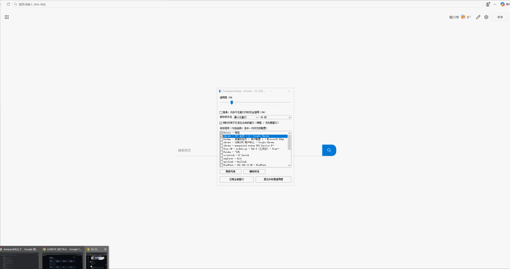
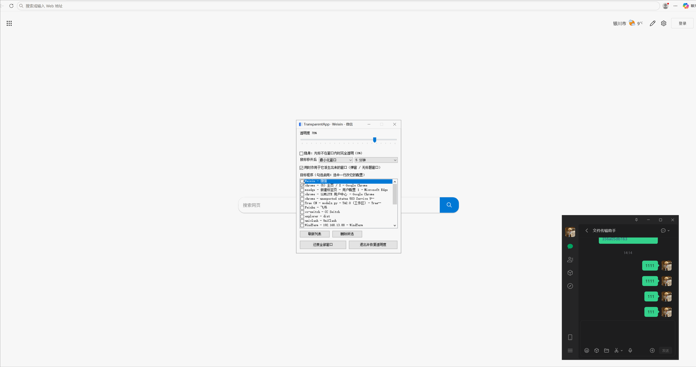

# TransparentApp：Windows 窗口透明度工具

TransparentApp 是一款 Windows 窗口透明度工具，可实时调节 Chrome、微信、QQ 等桌面应用的窗口透明度，并支持隐身模式和鼠标移开后自动最小化。

它适合多窗口办公、会议、直播和屏幕共享场景。项目采用 PowerShell 5.1、WinForms 和 Win32 API 构建，单文件运行、零第三方依赖、免安装。

## 主要功能

- 调节任意 Windows 应用窗口的透明度（0%~100%）
- 隐身模式：鼠标移开后完全透明，移入后恢复显示
- 鼠标移开后自动最小化或关闭窗口，并可设置延迟
- 支持关联处理目标窗口的子窗口和弹窗
- 提供托盘运行、异常恢复和批量还原功能
- 伪装外观：面板默认显示一个时钟，双击才露出真实控件；托盘图标和任务栏也显示为「时钟」

## 效果演示

**Chrome 窗口调透明度**



**微信窗口隐身打字**



## 亮点：打字的时候，别人看不到你的聊天内容

微信窗口勾上 `隐身` 之后，光标一离开窗口，它就直接压到完全透明；而**键盘焦点还在窗口里**，所以你可以继续打字，屏幕上却是一片空白。

别人从旁边走过，只会看到一个空窗口，看不到聊天内容、也看不到你正在输入什么。想看的时候把光标移回窗口，内容立刻恢复。

办公室、通勤路上、屏幕共享时处理私密对话，都不用再腾出一只手去挡屏幕。

## 运行

直接跑脚本（需要能执行 PowerShell 脚本）：

```powershell
powershell -ExecutionPolicy Bypass -File .\TransparentApp.ps1
```

终端会立刻返回（脚本自己甩到后台跑），屏幕上出现控制面板窗口，托盘出现图标。

或者打包成 exe 后双击：

```powershell
powershell -ExecutionPolicy Bypass -File .\build.ps1
.\dist\TransparentApp.exe
```

## 用法

1. `目标程序` 列表里勾选要管的窗口。**一行是一个窗口**——Chrome 开三个窗口就是三行，可以各配各的。
2. 选中某一行后，上面那些控件改的就是**这一个窗口**的配置，其他窗口不受影响。
3. 拖 `透明度` 滑块：0%~100%，实时生效。
4. `隐身`：勾上后，光标不在这个窗口上时它**完全透明**（alpha 0），光标移进去恢复成滑块设定的透明度。
   注意 alpha 0 的分层窗口同时不再接收鼠标点击（Windows 规则），点它会穿透到下面的窗口；靠本程序的轮询判定"光标进来了"来恢复显示。
5. `鼠标移开后` 选动作 + 延迟：动作有
   - `不做任何事`
   - `最小化窗口`
   - `关闭窗口` —— **关掉这个窗口和它派生出来的弹窗**，等于替你点了窗口右上角的 ×。
     只发 `WM_CLOSE`，**不会强制结束进程**，所以同一个程序里别的窗口不受影响。
     程序如果有未保存的内容，按它自己的方式处理（弹确认框或直接丢弃）；切到这一档时会先弹一个确认框。

   延迟可选 1 秒 / 2 秒 / 5 秒 / 30 秒 / 1 / 2 / 5 / 10 / 30 分钟（默认 5 分钟）。
6. `同时作用于它派生出来的窗口`：勾上后，这个窗口弹出的对话框、无标题弹窗（比如**微信的表情搜索面板**）会跟着一起透明化、一起最小化。
   判定顺序是"属主指向这个窗口" → "同进程下只挂了一个目标窗口"，所以它不会误伤同进程的其它主窗口。
7. `刷新列表` 重新扫描窗口，`删除所选` 把选中窗口从目标里去掉，`还原全部窗口` 恢复所有被本程序改过的窗口。

> 列表只列**有标题、非工具窗口**的主窗口。弹窗/面板自己当不了目标，只能挂在某个目标窗口下面跟着走。

> 有一类弹窗会被**跳过**：自己就用逐像素分层透明的窗口（Qt 的 `...PopupSaveBits` / `...ToolSaveBits`，
> 微信表情面板、QQ 邮箱小窗都是这种）。这类窗口套上「整窗统一透明度」会整块画不出来变成黑方块，
> 所以宁可让它保持不透明也不碰它。跳过时会记一行到 `ui.log`。

## 伪装

不想让人一眼看出这是个窗口透明度工具：面板的「门面」是一块走秒的时钟。

- 面板打开时先显示时钟；**双击时钟任意位置**（时间、日期或空白处）才切到真实控制面板。
- 回到时钟：在真实面板上按 `Esc`；或者点 X 收起面板再打开——每次重新打开都先显示时钟。
- 托盘图标、鼠标悬停文字、窗口标题、任务栏分组统一显示为「时钟」。

## 退出

点面板右上角 `X` **不是退出**，只是把面板收回托盘，透明度和最小化继续生效。
把面板最小化也一样——会直接收进托盘，任务栏不留按钮（留一个最小化窗口的话，
别的程序或系统一句 `SetForegroundWindow` 就能把它还原出来，看着就像「面板自己跳出来」）。

真正退出只有两条路：

- 面板里的 `退出并恢复透明度`
- 托盘图标右键 → `退出`

退出时会先把透明度和被本程序最小化的窗口都还原。用任务管理器强杀则不会还原。

面板收起后，托盘图标（Win11 可能折叠在任务栏 `^` 里）左键单击把面板叫回来，右键出菜单。

## 隐身是怎么判定的

判断"鼠标在不在这个窗口上"分两步，不是只看矩形：

1. 光标下那个顶层窗口是**这个目标自己人**——它本身、它的派生窗口，或挂在它们下面的弹窗 → 在里面。
   这里按窗口身份判断，不按进程：同一个 Chrome 开的另一个主窗口也属于 `chrome.exe`，但它不是这个目标，
   鼠标移到它上面就该隐身。
2. 否则看光标是否落在某个受管窗口的矩形内，**并且那个窗口压在光标下那个窗口上面**——
   被压住说明鼠标其实在别的窗口上。窗口自身 alpha 为 0 时是点不通的，`WindowFromPoint` 看不到它，
   这时只能靠 z 序判断。

所以一个**最大化**的窗口占满整屏时，只要鼠标没被别的窗口盖住就算"在里面"，它会一直显示——这是几何决定的，不是 bug。
想让隐身有实际效果，要么窗口别铺满整屏，要么把别的窗口盖在它上面。

## 异常退出后的收尾

- **能被捕获的崩溃**（事件回包或消息循环里抛异常）：主进程自己先把透明度和最小化状态还原，再退出。
- **被任务管理器强杀、蓝屏、断电**这类硬终止：主进程没机会执行任何代码，靠**看门狗**兜。

### 看门狗

每次启动主程序都会跟一个看门狗进程，它只做一件事：等主进程消失。主进程正常退出会先删掉现场文件
`%APPDATA%\TransparentApp\live.json`，看门狗醒来发现文件不在就什么都不做；文件还在就说明是异常退出，
于是按里面记的窗口句柄把透明度和最小化状态还原，并写一行记录到 `%APPDATA%\TransparentApp\recovery.log`。

看门狗是同一个 exe 的 `--watchdog` 模式，走 WMI 起，父进程是 `WmiPrvSE` 而不是主程序——**不在同一棵
进程树上**，所以任务管理器"结束任务"连带子树一起杀时它照样活着。

实测：强杀主进程，4 秒内窗口恢复原样、`live.json` 被清理、日志记下
`主进程 7124 异常退出，已还原 1 个窗口的透明度、0 个最小化窗口`。

另外启动时如果发现上次留下的 `live.json`（说明上次崩了而且看门狗也被一起杀了），会先补还原一次。

反面情况：如果连看门狗一起杀掉（例如 `taskkill /F /IM TransparentApp.exe`），就没人收尾了，这时手动跑：

  ```powershell
  powershell -ExecutionPolicy Bypass -File .\TransparentApp.ps1 -Restore
  ```

  它按 `config.json` 里记的目标进程名，把这些进程的所有窗口恢复正常（清掉 `WS_EX_LAYERED`）。

  如果配置也没了（换机器、配置被清），用核选项——它不管配置，直接把所有"被显式设过 alpha 且不是 255"
  的窗口恢复正常，并列出改过哪些：

  ```powershell
  powershell -ExecutionPolicy Bypass -File .\TransparentApp.ps1 -RestoreAll
  ```

## 自检

```powershell
# 枚举窗口 + 透明度往返 + 延迟判定 + 隐身判定（会短暂改动一个窗口）
powershell -ExecutionPolicy Bypass -File .\TransparentApp.ps1 -SelfTest

# 端到端：起真实面板，自动跑「勾选 -> 拖滑块 -> 开隐身 -> 点 X -> 退出」
powershell -ExecutionPolicy Bypass -File .\TransparentApp.ps1 -UiTest

# 收尾：按配置里记过的目标进程，把窗口恢复正常
powershell -ExecutionPolicy Bypass -File .\TransparentApp.ps1 -Restore
```

## 打包成 exe

```powershell
powershell -ExecutionPolicy Bypass -File .\build.ps1
```

产物是单个 `dist\TransparentApp.exe`（约 106 KB）：

- 用 Windows 自带的 `.NET Framework\...\csc.exe` 编译，不需要装 SDK、不需要联网。
- `TransparentApp.ps1` 和 `TransparentApp.ico` 以资源形式嵌进 exe，图标同时设为 exe 自身的图标。
- 启动时只解一个 `.ico` 到 `%LOCALAPPDATA%\TransparentApp\`。**脚本不落盘**：用 `System.Management.Automation`
  在 exe 自己的进程里直接执行，`Win` 类也预编译进 exe。所以运行时不会出现 `powershell.exe -ExecutionPolicy Bypass`
  子进程，也不会调 `Add-Type` 去现场编译 C#——连同「往 `%LOCALAPPDATA%` 写脚本」这三条，正是杀软判定释放器的特征。
- 单实例：exe 持有互斥量；重复双击不新开窗口，而是写一张 `show.request`，让已在跑的实例把面板调出来。
- 直接跑 `TransparentApp.ps1`（开发、`-SelfTest`、`-UiTest`、`-Restore`）需要同目录的 `Win.cs`，exe 不需要。

## 配置持久化

设置写在 `%APPDATA%\TransparentApp\config.json`，改完自动保存（拖动滑块时攒到轮询里写一次，不逐次落盘），退出时再存一次：

```json
{
  "follow": true,
  "targets": [
    { "proc": "chrome", "class": "Chrome_WidgetWin_1", "title": "xxx - Google Chrome",
      "alpha": 153, "stealth": false, "action": "minimize", "leaveMs": 300000 }
  ],
  "procDefaults": { "chrome": { "alpha": 153, "stealth": false, "action": "minimize", "leaveMs": 300000 } }
}
```

- `action` 取 `none` / `minimize` / `close`，旧版 `minimize: true|false` 自动升级成 `minimize` / `none`，
  更早的 `kill`（那时是结束整个进程）升级成 `close`。
- 窗口句柄每次启动都不一样，所以目标按 **进程名 + 窗口类 + 标题** 记住。
- **标题变了就认不回来**（Chrome 换了标签页就是这种），启动后重新勾一次即可。
- `procDefaults` 是每个进程上次用过的配置，勾这个进程的新窗口时拿它当初值，不用每次重调。
- 旧版按进程记的配置会自动升级：套到那个进程的第一个主窗口上。
- 配置在只读位置也不会出问题：写失败静默忽略，程序照常跑。

## 文件

- `TransparentApp.ps1`：全部逻辑。
- `TransparentApp.ico`：打包时嵌入 exe 的自身图标（资源管理器里看到的那个）。面板窗口和托盘
  图标现在是运行时绘制的时钟（伪装外观，见「伪装」一节），不再读这份 ico。
- 面板以前跑在 `powershell.exe` 里，所以要调 `SetCurrentProcessExplicitAppUserModelID`，
  否则任务栏会换成宿主的蓝色 PowerShell 图标；现在宿主就是 exe 自己，这一步留着但不再是必需
  （ID 值用「Clock」，任务栏分组不出现 TransparentApp）。
- `Win.cs`：全部 Win32 P/Invoke 与窗口枚举逻辑。`build.ps1` 把它编进 exe；直接跑 `.ps1` 时由脚本用
  `Add-Type -Path` 现场编译同一份文件，两边只有这一份真相。
- `Launcher.cs`：启动器。管单实例、解图标、用 `System.Management.Automation` 在进程内跑脚本。
- `build.ps1`：打包脚本，产出 `dist\TransparentApp.exe`。

## 限制

- 只做整窗统一 alpha，做不到「只透明背景」。
- 自己用逐像素分层透明的弹窗（Qt 的 PopupSaveBits 那类）会被跳过，见上面说明。
- 目标窗口的标题变了（Chrome 换标签页、文档改名）会导致下次启动认不回这个目标，需要重新勾一次。
- 透明度拉到 0% 且没开隐身时，窗口完全看不见也点不到，只能在面板里取消勾选或退出程序找回。
- 目标程序若以管理员运行，本脚本也要以管理员运行（UIPI）。
- 全屏独占的游戏 / DRM 视频无效。
- 仅支持 64 位 PowerShell（依赖 `GetWindowLongPtrW`）。
